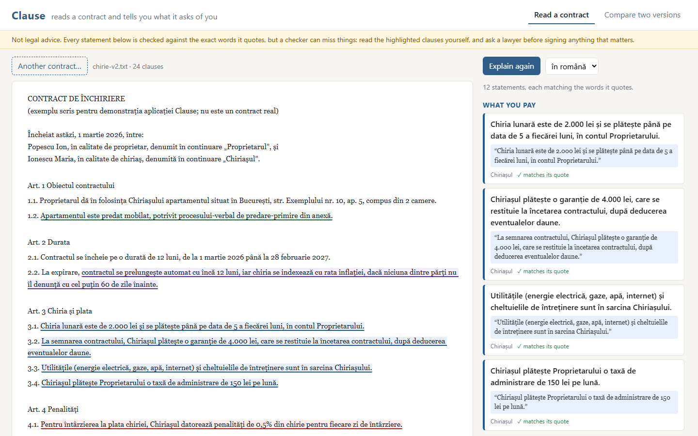
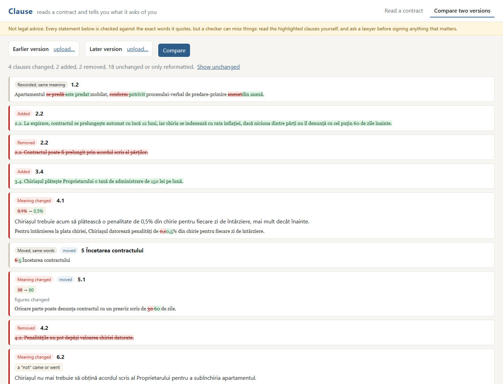

# Clause

Reads a contract (a lease, a loan, a subscription, a job offer) and tells you, in plain words, what
it asks of you:

- what you must do;
- what you pay: fees, commissions, interest, the annual percentage rate (DAE);
- the penalties;
- how the contract ends or renews;
- anything unusual.

Every statement comes with the exact sentence it rests on, highlighted in the contract, and is
checked against that sentence before you see it. It also compares two versions of a contract by
meaning: a raised penalty or a dropped "not" is flagged, a reworded sentence that says the same
thing is not.

**Clause is not legal advice**, and the app says so on every page. It runs entirely on your
computer: the contract never leaves it.





The screenshots use [samples/](samples/), a lease written for this demo in Romanian (one of the
two languages Clause reads, with English).

## How it works

```
 PDF / DOCX / text ──► Java (Spring Boot): read the text, split it into clauses, keep every position
                          │                                  │
                          ▼                                  ▼
 Python: Qwen2.5-7B lists findings,           Java: pair the clauses of two versions, diff the words,
 each with a quote, a few clauses at a time    find the figures and negations that changed
                          │                                  │
                          ▼                                  ▼
 Python: the checker holds each statement     Python: did each changed clause change its meaning?
 to its quote (anchor, numbers, names,         (changed figures or negations: yes; otherwise
 entailment); what fails is set aside           entailment both ways, sentence by sentence)
                          │                                  │
                          └──────────────► Vue (TypeScript) ◄┘
                    the contract with the quotes highlighted; the changes, explained
```

**Reading (Java).** Apache PDFBox and Apache POI read PDF and DOCX files:
- page numbers, and headers or footers repeated on most pages, are dropped;
- words hyphenated at line ends are joined;
- Word's automatic numbering, which is not part of a paragraph's text, is written out.

The clause splitter finds headings:
- keywords: "Article 4", "Art. 4", "Articolul IV", "Section 4.2", "§ 3";
- clause numbers: "4.", "4.2.1)";
- short lines in capitals.

A number counts only if it follows on from the one before, so "2.000 lei" at the start of a line is
not a clause. Headings are found inside long lines too, because PDF extraction often delivers a
contract as one line. The text is never changed, so every position the rest of the system reports
is a position in what the reader sees.

**Extraction (Python).** Clause asks Qwen2.5-7B-Instruct (llama.cpp, temperature 0, held to a JSON
schema) for six kinds of findings:
- what a party must do;
- payments;
- penalties;
- ending and renewal;
- liability;
- unusual clauses, with the reason they stand out.

The model reads about 3,500 characters of whole clauses at a time, with the contract's opening for
context. Each finding is a one-sentence summary plus a quote copied from the text.

**The checker (anti-hallucination).** Nothing the model says is shown as fact until it passes four
checks ([service/clause_service/verify.py](service/clause_service/verify.py)):

1. **Anchor.** The quote must be in the contract. Both sides are compared with typography unified
   (curly and straight quotes, dashes, spaces), and the match is mapped back to the original
   characters. A near-copy (at least 90 of 100 by rapidfuzz, covering nearly all the quote) is
   repaired to the real text. Everything after this checks against the real text, not the model's
   copy.
2. **Numbers.** Every number in the statement must be in the quote. "1.500 lei", "1,500" and
   "fifteen hundred" are compared as values.
3. **Names.** Every name in the statement (the Landlord, Zynga, the Bank) must be in the quote. An
   entailment model accepts "the Landlord pays 0.1% per day" from "the Tenant pays 0.1% per day";
   this check does not.
4. **Entailment.** A multilingual inference model (mDeBERTa-v3, XNLI) reads the quote as premise and
   the statement as hypothesis. It must find the statement entailed (at least 0.5) and not
   contradicted (below 0.3).

A statement that fails a check is set aside with the reason ("the 60 is not in the quote"). The
reader can open the set-aside statements; they are never mixed in with the confirmed ones.

**Comparing versions.**
- **Pairing (Java).** The clauses of two versions are paired by what they say (word-pair overlap,
  figures masked), so a renumbered or moved clause is still the same clause. A heavily rewritten
  clause with the same number is paired too.
- **What changed (Java).** For each pair Java computes a word diff (Myers), the figures that changed
  (amounts, rates, terms, dates, compared as values) and whether a negation came or went.
- **Meaning (Python).** A changed figure or negation means the meaning changed. Otherwise the
  changed sentences are paired, and each must entail the other, both ways, at 0.8 or more. If all
  do, the clause was only reworded.
- **Explanation.** The model explains each change of meaning in one sentence. That sentence goes
  through the same number and name checks, and is dropped if it fails.

## Results

All on real contracts: [CUAD](https://www.atticusprojectai.org/cuad) (Hendrycks et al., NeurIPS
2021; CC BY 4.0), 510 commercial contracts whose clauses lawyers labelled in 41 categories, each
label an exact span of the text. The model is Qwen2.5-7B-Instruct (Q4_K_M) on an RTX 2060.

### Extraction: does Clause find what matters?

30 CUAD contracts, picked at random among those under 40,000 characters (median: 19,000 characters,
30 clauses). Their 192 labelled spans fall in the 17 CUAD categories that are what Clause looks for:
- termination for convenience;
- renewal term and the notice to stop a renewal;
- liquidated damages;
- caps on liability and uncapped liability;
- minimum commitments, revenue sharing and price restrictions;
- non-compete, exclusivity and non-solicitation;
- audit rights and insurance;
- and others of the kind.

A span counts as found when a finding's quote overlaps it.

| | Labelled spans found |
|---|---|
| by any finding | **82%** |
| by a finding that passed the checks | 56% |
| by a finding that passed the checks, of the matching kind | 49% |

Renewal terms (12 of 13), notices to stop a renewal (8 of 9), non-solicitation (7 of 9) and
non-disparagement (5 of 5) are found reliably. Exclusivity (35% verified) and audit rights (36%) are
found least often.

The 30 contracts gave 1,038 findings (a median of 29 per contract), in a median of 2.8 minutes each:
- **anchoring:** 81% of the quotes were exact, 15% were repaired to the real text, and 4% were
  quotes the contract does not contain;
- **verdict:** 63% passed every check.

### The checker against hand labels

99 findings, drawn at random, were labelled by hand: does the statement say what its quote says
(same parties, same figures, nothing added)? [bench/finding-labels.jsonl](bench/finding-labels.jsonl)

| | |
|---|---|
| Statements that are correct, before the checks | 82% |
| Statements that are correct, among those that pass | **93%** |
| Wrong statements set aside | 72% (13 of 18) |
| Correct statements set aside as well | 21% (17 of 81) |

The checks cut the wrong statements from 18% to 7%.

**What they cost.** Most correct statements set aside fail the names check: the model writes a
party's name ("Ashworth", "the REIT") where the quote uses the contract's defined term ("the
Company"). Loosening the check to accept any party of the contract would let swapped parties
through; Clause keeps it strict and shows the set-aside statements on request.

**What still slips through.** The 5 wrong statements that pass are subtler:
- a reversed direction ("the Sponsor must provide reports" for "drkoop.com shall provide the
  Sponsor with reports": both names are in the quote);
- a qualification dropped ("may adjust the quota" without "by mutual agreement");
- a summary that garbles a jurisdiction clause.

### The checker against errors put in on purpose

The 659 findings that passed were each corrupted in one way, as a model gets things wrong, and
checked again ([evaluate_verifier.py](service/clause_service/evaluate_verifier.py)):

| Corruption | Caught |
|---|---|
| A number changed (30 days -> 60 days) | 97% of 87 |
| The statement negated ("shall" -> "shall not") | 94% of 415 |
| A party swapped for another party of the contract | 89% of 522 |
| The quote of another finding put in its place | 99.7% of 657 |
| The statement offered as its own quote (words not in the contract) | 94% of 659 |
| Not corrupted: still passes | 99.8% of 659 |

Some misses are artefacts of the corruption, not of the checker:
- the new number was already in the quote (30 -> 60, in a clause that also gives 60 days);
- a "party" was swapped for a capitalised word that is not one ("Advertising");
- an "invented" quote happened to be the contract's own words.

### Comparing versions

8 CUAD contracts each got a second version with one known edit, and the two versions were compared
through the backend exactly as the app compares them
([evaluate_diff.py](service/clause_service/evaluate_diff.py)). There are 7 kinds of edit, one
contract each:
- **edits that change the contract:** a figure (an amount, a rate, a number of days), "shall"
  becoming "shall not", a clause deleted, a clause from another contract inserted;
- **edits that do not:** two clauses swapped, line breaks and spacing changed with a heading in
  capitals, and legal phrasing replaced by plain phrasing with the same meaning ("shall" -> "will",
  "prior to" -> "before", "in the event that" -> "if", "pursuant to" -> "under", ...).

| Edit | Clause | Clause before sentence matching and the obligation check | Word diff of aligned clauses |
|---|---|---|---|
| A figure changed: reported | **5 of 5** | 5 of 5 | 5 of 5 |
| A "not" added: reported | **8 of 8** | 8 of 8 | 8 of 8 |
| A clause deleted: reported | **8 of 8** | 8 of 8 | 8 of 8 |
| A clause inserted: reported | **8 of 8** | 8 of 8 | 8 of 8 |
| Two clauses swapped: no false alarm | **8 of 8** | 1 of 8 | 1 of 8 |
| Reformatted: no false alarm | **7 of 8** | 0 of 8 | 0 of 8 |
| Reworded, same meaning: no false alarm | **4 of 8** | 2 of 8 | 0 of 8 |

(The figure edit applies only where a clause has a figure with a unit: 5 of the 8 contracts.)

**What made the difference.**
- **Sentences found elsewhere.** A swap or a reformatting moves where one clause ends and the next
  begins: a clause number out of sequence after a swap is no longer a heading, and its text joins
  the clause before. Only sentences that exist nowhere in the other version now count as changed.
- **Obligation versus permission.** "May" against "shall" is now checked word by word, the way
  figures and negations are. That let the entailment threshold drop from 0.8 to 0.5, chosen on 200
  CUAD sentences reworded the same way: 0.8 called 40% of them changed, 0.5 called 15%.

**What is still weak.** Rewording: in 4 of the 8 reworded contracts, the entailment model still
judged one of the reworded sentences, read both ways, to say something different. The changes that
matter were never missed. With 8 contracts per edit, these are indications, not precise rates.

## Running it

What you need:
- Java 21;
- Node 22 or newer;
- Python 3.14;
- an NVIDIA GPU for the language model.

```bash
bash scripts/fetch-deps.sh
```

```bash
cd service && python -m venv .venv && .venv/Scripts/pip install -r requirements.txt --index-url https://download.pytorch.org/whl/cu128 --extra-index-url https://pypi.org/simple
```

```bash
cd frontend && npm ci && npm run build
```

`fetch-deps.sh` gets llama.cpp's server and Qwen2.5-7B (4.7 GB). `npm run build` builds the
frontend into the backend.

Then start the two parts:

```bash
cd service && .venv/Scripts/python -m clause_service.server
```

```bash
cd backend && ./mvnw spring-boot:run
```

and open http://127.0.0.1:8080.

- The analysis service starts llama-server itself, and loads the entailment model on first use (it
  downloads the model then).
- Both listen on 127.0.0.1 only.
- Contracts are kept in memory for the session and never written to disk.

Without the analysis service, Clause still reads and compares contracts. It only cannot explain
them, or tell a reworded clause from a changed one.

Tests:
- `./mvnw test` in `backend/` runs 23 tests: reading, splitting, facts, diff, alignment, and the API
  with the service mocked;
- `python -m pytest` in `service/` runs 17 tests: the four checks, the comparison and the API, with
  stand-in models;
- `npx vitest run` in `frontend/` runs 5 tests: the highlighting.

To reproduce the results:

```bash
bash scripts/fetch-deps.sh --cuad
```

```bash
cd service && python -m clause_service.evaluate_extraction && python -m clause_service.evaluate_verifier && python -m clause_service.evaluate_diff
```

Run them with the backend and the analysis service up.

## Layout

```
backend/    Spring Boot: document/ (reading, clause splitting), diff/ (facts, word diff, alignment), web/ (API, in-memory store)
service/    Python: extract.py (the model), anchor.py, numbers.py, nli.py, verify.py (the checks), compare.py, server.py, evaluate_*.py
frontend/   Vue 3 + TypeScript: the contract with quotes highlighted, the findings, the comparison
samples/    a Romanian lease in two versions, written for the demo
bench/      the hand labels of 99 findings
results/    every number above, as JSON
```

## Licenses

Clause is MIT ([LICENSE](LICENSE)). It uses:

| Component | License |
|---|---|
| Spring Boot, Apache PDFBox, Apache POI | Apache 2.0 |
| Vue, Vite | MIT |
| Qwen2.5-7B-Instruct | Apache 2.0 |
| llama.cpp | MIT |
| mDeBERTa-v3-base-xnli-multilingual-nli-2mil7 | MIT |
| PyTorch, Transformers, FastAPI, RapidFuzz | BSD / Apache 2.0 / MIT / MIT |
| CUAD v1 (evaluation only, not in this repository) | CC BY 4.0, The Atticus Project |
